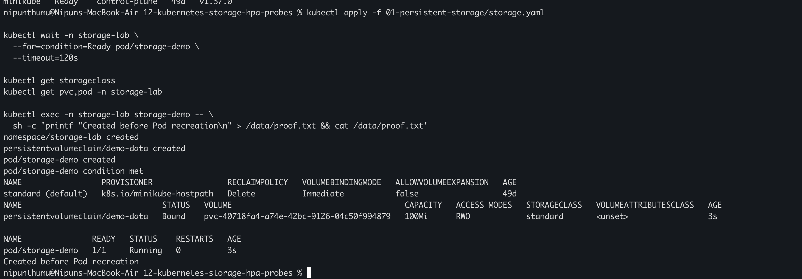
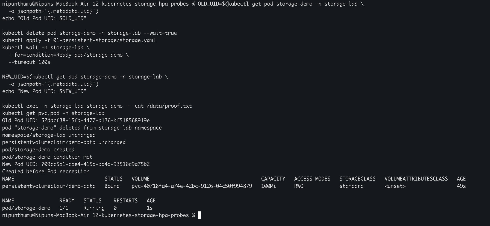
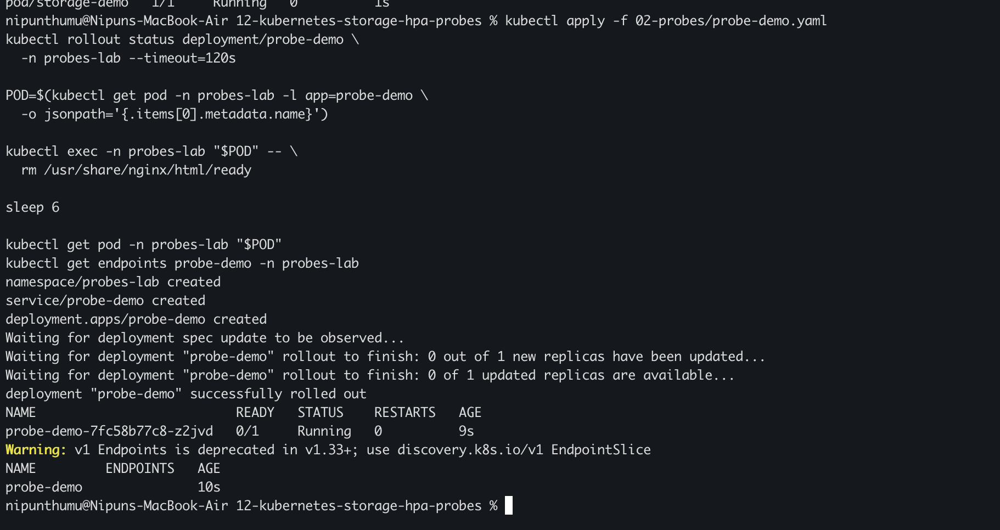
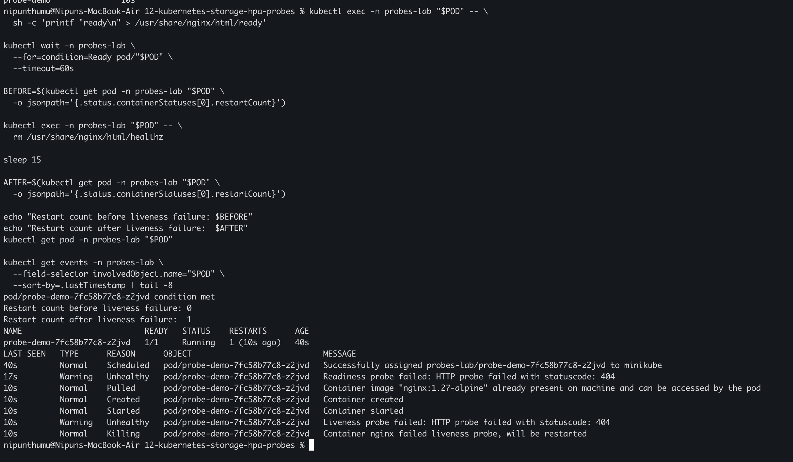
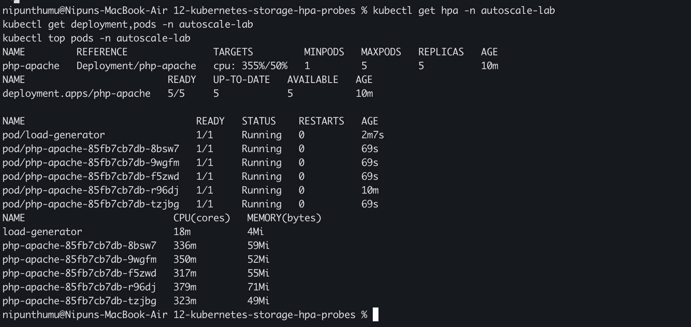
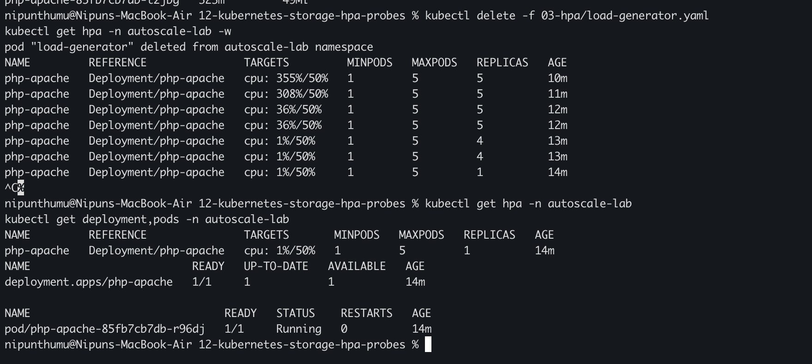

# My Kubernetes Storage, Autoscaling and Probes Practice

I used my local Minikube cluster on macOS with the Docker driver to practise
persistent storage, readiness and liveness probes, and CPU-based horizontal
autoscaling. The YAML files in this folder are the exact manifests I used in
the lab.

## Task 1: Prove that data survives Pod recreation

Manifest: [`01-persistent-storage/storage.yaml`](01-persistent-storage/storage.yaml)

I created a namespace, a dynamically provisioned `PersistentVolumeClaim`, and
a BusyBox Pod that mounts the claim at `/data`.

```bash
kubectl apply -f 01-persistent-storage/storage.yaml
kubectl wait -n storage-lab --for=condition=Ready pod/storage-demo --timeout=120s

kubectl get storageclass
kubectl get pvc,pod -n storage-lab
kubectl exec -n storage-lab storage-demo -- \
  sh -c 'printf "Created before Pod recreation\n" > /data/proof.txt && cat /data/proof.txt'
```

The first verification showed the default `standard` StorageClass, the
`demo-data` claim in `Bound` state, the Pod at `1/1 Running`, and the text that
was written to `/data/proof.txt`.



I then deleted only the Pod, created it again from the same manifest, and read
the file from the unchanged claim:

```bash
OLD_UID=$(kubectl get pod storage-demo -n storage-lab -o jsonpath='{.metadata.uid}')
echo "Old Pod UID: $OLD_UID"
kubectl delete pod storage-demo -n storage-lab --wait=true
kubectl apply -f 01-persistent-storage/storage.yaml
kubectl wait -n storage-lab --for=condition=Ready pod/storage-demo --timeout=120s
NEW_UID=$(kubectl get pod storage-demo -n storage-lab -o jsonpath='{.metadata.uid}')
echo "New Pod UID: $NEW_UID"
kubectl exec -n storage-lab storage-demo -- cat /data/proof.txt
kubectl get pvc,pod -n storage-lab
```

The original Pod UID was `52dacf38-15fa-4477-a136-bf518568919e`. After deleting
and recreating only the Pod, its UID was
`709cc5a1-cae4-415a-ba4d-93516c9a75b2`. The claim remained bound to volume
`pvc-40718fa4-a74e-42bc-9126-04c50f994879`, and the new Pod printed the
original text.



The Pod is disposable, while the claim represents storage with a lifecycle
independent of that Pod. Reusing the claim mounts the same data into the new
Pod.

## Task 2: Observe readiness and liveness behavior

Manifest: [`02-probes/probe-demo.yaml`](02-probes/probe-demo.yaml)

The Nginx container creates two health files when it starts. The readiness
probe checks `/ready`; the liveness probe checks `/healthz`.

```bash
kubectl apply -f 02-probes/probe-demo.yaml
kubectl rollout status deployment/probe-demo -n probes-lab --timeout=120s
kubectl get deployment,pods -n probes-lab -o wide
```

I first removed only the readiness file:

```bash
POD=$(kubectl get pod -n probes-lab -l app=probe-demo \
  -o jsonpath='{.items[0].metadata.name}')
kubectl exec -n probes-lab "$POD" -- rm /usr/share/nginx/html/ready
sleep 6
kubectl get pod -n probes-lab "$POD"
kubectl get endpoints probe-demo -n probes-lab
```



The Pod remained `Running` with zero restarts, but its readiness changed to
`0/1` and the Service no longer had a ready endpoint. This demonstrated that a
failed readiness probe stops traffic without restarting the container. The
warning refers to the older `Endpoints` API; `EndpointSlice` is the current
replacement and the warning did not affect the test.

I restored readiness and then removed the liveness health file:

```bash
kubectl exec -n probes-lab "$POD" -- \
  sh -c 'printf "ready\n" > /usr/share/nginx/html/ready'
kubectl wait -n probes-lab --for=condition=Ready pod/"$POD" --timeout=60s

BEFORE=$(kubectl get pod -n probes-lab "$POD" \
  -o jsonpath='{.status.containerStatuses[0].restartCount}')
kubectl exec -n probes-lab "$POD" -- rm /usr/share/nginx/html/healthz
sleep 15
AFTER=$(kubectl get pod -n probes-lab "$POD" \
  -o jsonpath='{.status.containerStatuses[0].restartCount}')
echo "Restart count before liveness failure: $BEFORE"
echo "Restart count after liveness failure:  $AFTER"
kubectl get pod -n probes-lab "$POD"
kubectl get events -n probes-lab \
  --field-selector involvedObject.name="$POD" \
  --sort-by=.lastTimestamp | tail -8
```



The restart count increased from `0` to `1`. Events recorded the HTTP `404`,
the failed liveness probe, and kubelet killing the unhealthy container. The
same Pod recovered to `1/1 Running` because the container startup command
recreated both health files.

## Task 3: Scale a Deployment using CPU utilization

Manifests:

- [`03-hpa/application.yaml`](03-hpa/application.yaml)
- [`03-hpa/load-generator.yaml`](03-hpa/load-generator.yaml)

HPA requires CPU metrics. I enabled and verified the Minikube
`metrics-server` addon:

```bash
minikube addons enable metrics-server
kubectl rollout status deployment/metrics-server -n kube-system --timeout=180s
kubectl top nodes
```

I deployed the application with a `100m` CPU request and waited for its first
metric sample:

```bash
kubectl apply -f 03-hpa/application.yaml
kubectl rollout status deployment/php-apache -n autoscale-lab --timeout=180s
kubectl get deployment,service,hpa -n autoscale-lab
kubectl top pods -n autoscale-lab
```

I then started ten concurrent request workers in the load-generator Pod and
watched the HPA:

```bash
kubectl apply -f 03-hpa/load-generator.yaml
kubectl wait -n autoscale-lab --for=condition=Ready pod/load-generator --timeout=120s
kubectl get hpa -n autoscale-lab -w
```

After the replica count increased, I stopped the watch and inspected the
Deployment, Pods, and their CPU consumption:

```bash
kubectl get hpa -n autoscale-lab
kubectl get deployment,pods -n autoscale-lab -o wide
kubectl top pods -n autoscale-lab
```



The measured CPU utilization reached `355%` against the `50%` target. HPA
scaled the Deployment to its configured maximum of five replicas, and all five
application Pods were `1/1 Running`. Each application Pod was actively using
approximately `317m` to `379m` of CPU during the captured test.

I deleted the load generator and watched the HPA reduce the replica count. The
manifest uses a 60-second scale-down stabilization window so that this lab can
be observed without waiting for the default five-minute window.

```bash
kubectl delete -f 03-hpa/load-generator.yaml
kubectl get hpa -n autoscale-lab -w
```



After load stopped, the reported utilization fell from `355%` to `1%`. The HPA
reduced the Deployment from five replicas to four and finally to one. The
Deployment defines a CPU request because HPA calculates utilization as a
percentage of requested CPU. Under sustained load it increased replicas, and
after demand disappeared it reduced them within the configured bounds.

## Cleanup

```bash
kubectl delete namespace storage-lab probes-lab autoscale-lab
```

Deleting `storage-lab` also deletes its namespaced PVC. On Minikube's default
dynamic provisioner, the associated volume normally uses a `Delete` reclaim
policy and is removed as well.

## What I understood

- A PVC requests storage, while a PV represents the cluster storage resource
  bound to that request.
- Pod recreation does not remove data kept on an unchanged persistent volume.
- Readiness controls whether a Pod should receive traffic; liveness controls
  whether kubelet should restart its container.
- HPA needs resource requests and a working metrics pipeline to make CPU-based
  scaling decisions.
- Kubernetes scaling and health decisions are asynchronous, so verification
  should include both resource status and recent events.

## References

- [Persistent Volumes](https://kubernetes.io/docs/concepts/storage/persistent-volumes/)
- [Configure liveness, readiness and startup probes](https://kubernetes.io/docs/tasks/configure-pod-container/configure-liveness-readiness-startup-probes/)
- [Horizontal Pod Autoscaling](https://kubernetes.io/docs/tasks/run-application/horizontal-pod-autoscale/)
