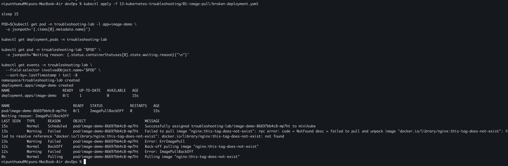
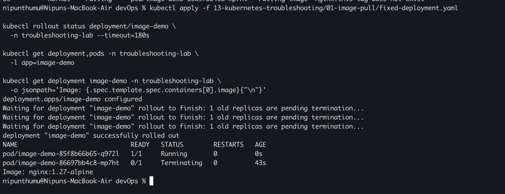

# My Kubernetes Troubleshooting Practice

I used my local Minikube cluster on macOS with the Docker driver to practise a
repeatable troubleshooting workflow. Each incident starts with an intentionally
broken Kubernetes resource, uses status, logs, descriptions, and events to find
the cause, and ends with a verified correction. The YAML files in this folder
are the exact manifests I used in the lab.

## Task 1: Diagnose and correct ImagePullBackOff

Manifests:

- [`01-image-pull/broken-deployment.yaml`](01-image-pull/broken-deployment.yaml)
- [`01-image-pull/fixed-deployment.yaml`](01-image-pull/fixed-deployment.yaml)

I first deployed Nginx with an image tag that does not exist:

```bash
kubectl apply -f 01-image-pull/broken-deployment.yaml
sleep 15

POD=$(kubectl get pod -n troubleshooting-lab -l app=image-demo \
  -o jsonpath='{.items[0].metadata.name}')
kubectl get deployment,pods -n troubleshooting-lab
kubectl get pod -n troubleshooting-lab "$POD" \
  -o jsonpath='Waiting reason: {.status.containerStatuses[0].state.waiting.reason}{"\n"}'
kubectl get events -n troubleshooting-lab \
  --field-selector involvedObject.name="$POD" \
  --sort-by=.lastTimestamp | tail -8
```

The Pod could not start because kubelet could not download the nonexistent
image. `kubectl get` showed the waiting state, while the Pod events exposed the
failed image pull and back-off messages.



I corrected the image tag and verified the rollout:

```bash
kubectl apply -f 01-image-pull/fixed-deployment.yaml
kubectl rollout status deployment/image-demo \
  -n troubleshooting-lab --timeout=180s
kubectl get deployment,pods -n troubleshooting-lab -l app=image-demo
kubectl get deployment image-demo -n troubleshooting-lab \
  -o jsonpath='Image: {.spec.template.spec.containers[0].image}{"\n"}'
```

The replacement Pod reached `1/1 Running` with the valid
`nginx:1.27-alpine` image. At the moment of verification, the broken Pod was
still terminating while its healthy replacement was already available.



## Task 2: Diagnose and correct CrashLoopBackOff

Manifests:

- [`02-crash-loop/broken-deployment.yaml`](02-crash-loop/broken-deployment.yaml)
- [`02-crash-loop/fixed-deployment.yaml`](02-crash-loop/fixed-deployment.yaml)

The sample application deliberately exits unless `STARTUP_MODE` is set to
`healthy`. I first deployed it with the wrong value:

```bash
kubectl apply -f 02-crash-loop/broken-deployment.yaml
sleep 20

POD=$(kubectl get pod -n troubleshooting-lab -l app=crashloop-demo \
  -o jsonpath='{.items[0].metadata.name}')
kubectl get pod -n troubleshooting-lab "$POD"
kubectl logs -n troubleshooting-lab "$POD" --previous
kubectl get pod -n troubleshooting-lab "$POD" \
  -o jsonpath='Last exit code: {.status.containerStatuses[0].lastState.terminated.exitCode}{"\n"}Restart count: {.status.containerStatuses[0].restartCount}{"\n"}'
kubectl get events -n troubleshooting-lab \
  --field-selector involvedObject.name="$POD" \
  --sort-by=.lastTimestamp | tail -8
```

The previous container log identified the invalid setting, the last state
showed exit code `1`, and the restart count confirmed that kubelet was repeatedly
trying to recover the container.

I changed `STARTUP_MODE` to `healthy` and verified recovery:

```bash
kubectl apply -f 02-crash-loop/fixed-deployment.yaml
kubectl rollout status deployment/crashloop-demo \
  -n troubleshooting-lab --timeout=180s

POD=$(kubectl get pod -n troubleshooting-lab -l app=crashloop-demo \
  -o jsonpath='{.items[0].metadata.name}')
kubectl get deployment,pods -n troubleshooting-lab -l app=crashloop-demo
kubectl logs -n troubleshooting-lab "$POD"
```

The corrected Pod stayed `1/1 Running`, and its log confirmed that the healthy
configuration was accepted.

## Task 3: Diagnose and correct a Service selector

Manifests:

- [`03-service-selector/broken-service.yaml`](03-service-selector/broken-service.yaml)
- [`03-service-selector/fixed-service.yaml`](03-service-selector/fixed-service.yaml)

I deployed an Nginx backend labelled `app=selector-demo`, a client Pod, and a
Service that initially selected the nonexistent label `app=selector-error`:

```bash
kubectl apply -f 03-service-selector/broken-service.yaml
kubectl rollout status deployment/selector-demo \
  -n troubleshooting-lab --timeout=180s
kubectl wait -n troubleshooting-lab \
  --for=condition=Ready pod/service-client --timeout=120s

kubectl get pods -n troubleshooting-lab -l app=selector-demo --show-labels
kubectl get service selector-demo -n troubleshooting-lab \
  -o jsonpath='Service selector: {.spec.selector}{"\n"}'
kubectl describe service selector-demo -n troubleshooting-lab | \
  grep -E 'Selector:|Endpoints:'
kubectl exec -n troubleshooting-lab service-client -- \
  sh -c 'wget -qO- -T 3 http://selector-demo || echo "Request failed: no ready Service endpoint"'
```

The backend Pod was healthy, but its label did not match the Service selector.
The Service therefore had no endpoint and the in-cluster request failed.

I corrected only the Service selector and repeated the checks:

```bash
kubectl apply -f 03-service-selector/fixed-service.yaml
kubectl get service selector-demo -n troubleshooting-lab \
  -o jsonpath='Service selector: {.spec.selector}{"\n"}'
kubectl describe service selector-demo -n troubleshooting-lab | \
  grep -E 'Selector:|Endpoints:'
kubectl exec -n troubleshooting-lab service-client -- \
  sh -c 'wget -qO- -T 5 http://selector-demo | grep -i "<title>"'
```

The corrected selector matched the ready Nginx Pod, the Service gained an
endpoint, and the client received the Nginx page through the Service name.

## Cleanup

```bash
kubectl delete namespace troubleshooting-lab
```

## What I understood

- Start with `kubectl get` to identify the failing workload and its current
  state, then use descriptions, logs, and events to narrow the cause.
- `ImagePullBackOff` usually means kubelet cannot retrieve the specified image;
  Pod events reveal the registry error and the exact image reference.
- `CrashLoopBackOff` means a container repeatedly starts and exits. Current or
  previous logs and the last termination state usually reveal why.
- A healthy backend does not make a Service functional if its selector does
  not match the Pod labels. The endpoint list connects those two views.
- A fix is not complete until the replacement workload is ready and the
  original user-facing behavior succeeds.

## References

- [Debug Pods](https://kubernetes.io/docs/tasks/debug/debug-application/debug-pods/)
- [Debug Services](https://kubernetes.io/docs/tasks/debug/debug-application/debug-service/)
- [Kubernetes Events](https://kubernetes.io/docs/reference/kubernetes-api/cluster-resources/event-v1/)
