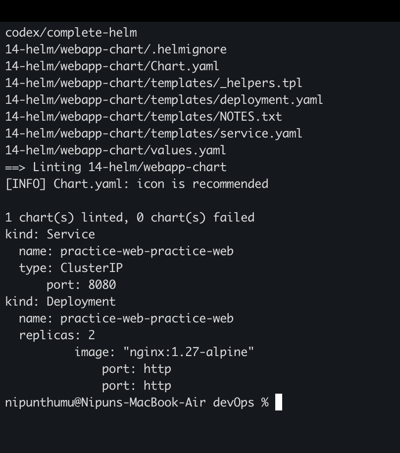
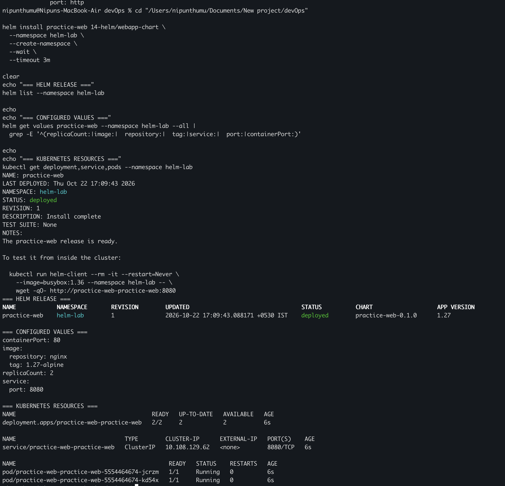
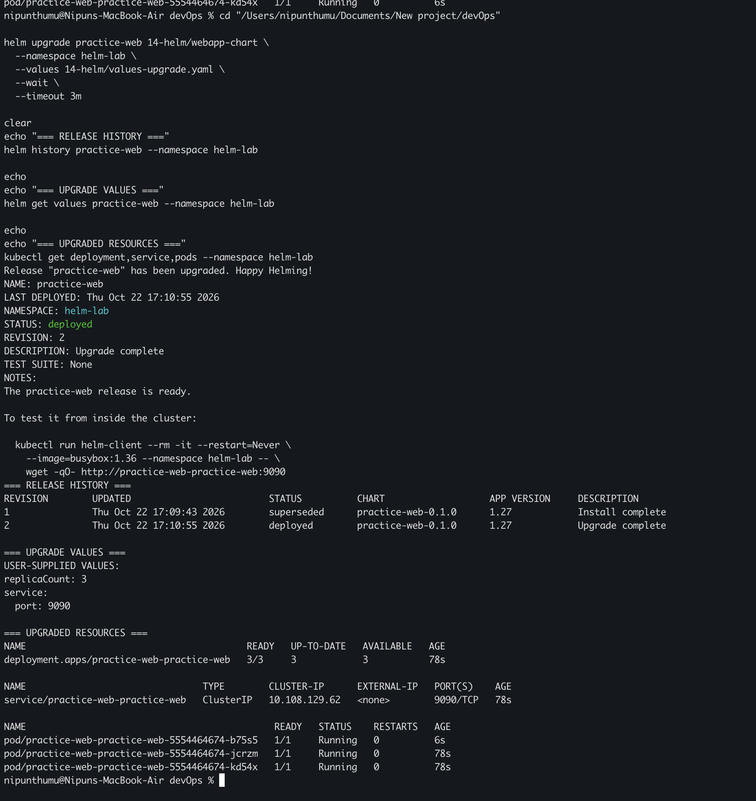

# My Helm Chart and Release Lifecycle Practice

I used Helm with my local Minikube cluster to package and operate a configurable
Nginx application. I created the chart files myself, rendered and linted them,
installed a release, upgraded its values, inspected revision history, and
rolled it back. The chart and values files in this folder are the exact files I
used in the lab.

## Task 1: Create and inspect a Helm chart

Chart: [`webapp-chart`](webapp-chart)

The chart contains three main parts:

- [`Chart.yaml`](webapp-chart/Chart.yaml) stores package metadata, including
  the chart name, chart version, and application version.
- [`values.yaml`](webapp-chart/values.yaml) defines configurable defaults such
  as replica count, image, ports, and resource requests.
- [`templates`](webapp-chart/templates) contains Kubernetes manifests with Go
  template expressions that read those values.

I inspected the chart, ran Helm's static checks, and rendered the manifests
without installing them:

```bash
find 14-helm/webapp-chart -maxdepth 3 -type f | sort
echo
helm lint 14-helm/webapp-chart
echo
helm template practice-web 14-helm/webapp-chart \
  --namespace helm-lab | \
  grep -E '^(kind:|[[:space:]]+(name: practice-web|replicas:|image:|type:|port:))'
```

`helm lint` checks the chart structure and catches common template errors.
`helm template` renders ordinary Kubernetes YAML locally, which makes it useful
for reviewing changes before they reach a cluster.



## Task 2: Install and verify a configurable release

I installed the chart as release `practice-web` in namespace `helm-lab`:

```bash
helm install practice-web 14-helm/webapp-chart \
  --namespace helm-lab \
  --create-namespace \
  --wait \
  --timeout 3m

helm list --namespace helm-lab
helm get values practice-web --namespace helm-lab --all | \
  grep -E '^(replicaCount:|image:|  repository:|  tag:|service:|  port:|containerPort:)'
kubectl get deployment,service,pods --namespace helm-lab
```

The default values deploy two Nginx replicas using image
`nginx:1.27-alpine`. The ClusterIP Service accepts traffic on configurable port
`8080` and forwards it to the named HTTP container port.



## Task 3: Upgrade the release and inspect its history

Upgrade values: [`values-upgrade.yaml`](values-upgrade.yaml)

I upgraded the release to three replicas and changed the Service port to
`9090`:

```bash
helm upgrade practice-web 14-helm/webapp-chart \
  --namespace helm-lab \
  --values 14-helm/values-upgrade.yaml \
  --wait \
  --timeout 3m

helm history practice-web --namespace helm-lab
helm get values practice-web --namespace helm-lab
kubectl get deployment,service,pods --namespace helm-lab
```

The successful upgrade created release revision `2`. Helm retained revision
`1`, allowing the change to be audited and reversed.



## Task 4: Roll back to the original revision

I rolled the release back to revision `1` and verified the effective values and
resources:

```bash
helm rollback practice-web 1 \
  --namespace helm-lab \
  --wait \
  --timeout 3m

helm history practice-web --namespace helm-lab
helm get values practice-web --namespace helm-lab --all | \
  grep -E '^(replicaCount:|service:|  port:)'
kubectl get deployment,service,pods --namespace helm-lab
```

Helm recorded the rollback as a new deployed revision rather than deleting
history. The application returned to two replicas and Service port `8080`.

## Cleanup

```bash
helm uninstall practice-web --namespace helm-lab
kubectl delete namespace helm-lab
```

## What I understood

- A chart packages related Kubernetes resources and exposes selected settings
  through values instead of duplicating manifests.
- `Chart.yaml` describes the package, `values.yaml` supplies defaults, and the
  `templates` directory turns those values into Kubernetes objects.
- `helm lint` and `helm template` provide useful checks before installation.
- A Helm release is a named installation with revision history in a namespace.
- `helm upgrade` creates a new revision, while `helm rollback` applies an older
  revision as a new current revision and preserves the audit trail.
- `--wait` makes install, upgrade, and rollback commands report success only
  after the selected Kubernetes resources become ready.

## References

- [Helm charts](https://helm.sh/docs/topics/charts/)
- [Helm template functions and pipelines](https://helm.sh/docs/chart_template_guide/functions_and_pipelines/)
- [Helm install](https://helm.sh/docs/helm/helm_install/)
- [Helm upgrade](https://helm.sh/docs/helm/helm_upgrade/)
- [Helm rollback](https://helm.sh/docs/helm/helm_rollback/)
