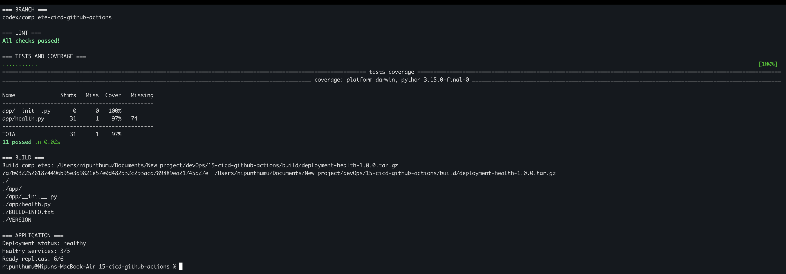
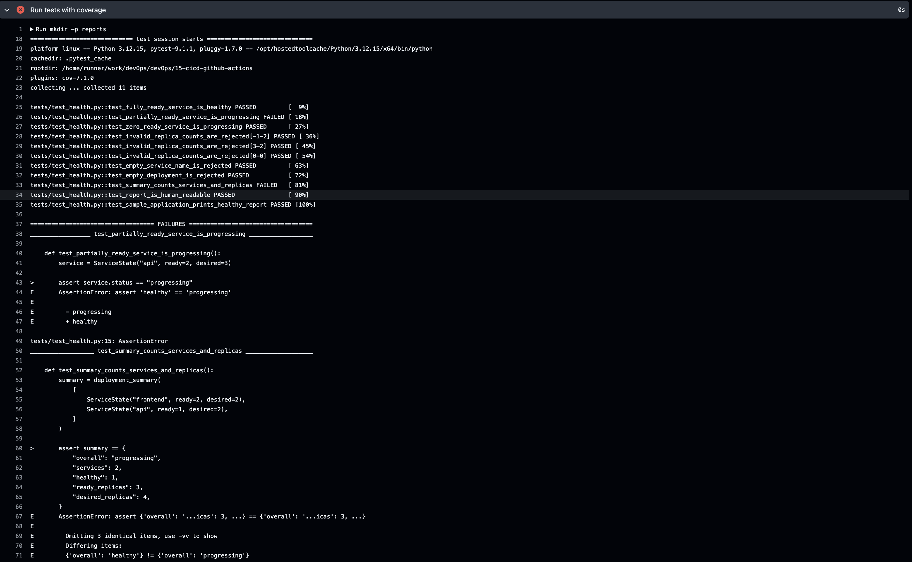
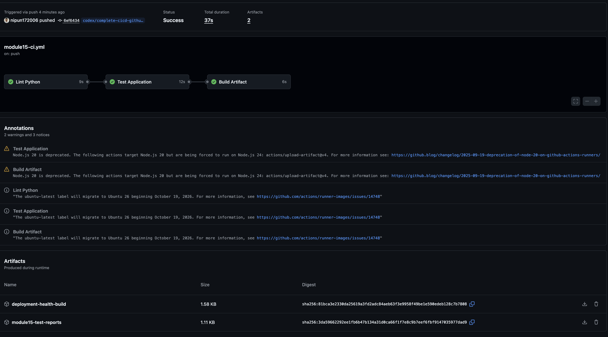

# My CI Pipeline with GitHub Actions

I built a small Python deployment-health utility and automated its quality
checks with GitHub Actions. The workflow is triggered by relevant pushes and
pull requests, runs linting and tests on a GitHub-hosted runner, blocks the
build when a test fails, and uploads both test reports and a packaged build as
downloadable artifacts.

## Pipeline flow

```text
Push or pull request
        |
        v
      Lint
        |
        v
      Tests --------> test reports
        |
        v
      Build --------> packaged artifact + checksum
```

Workflow: [`../.github/workflows/module15-ci.yml`](../.github/workflows/module15-ci.yml)

## Task 1: Build and test the application locally

Application files:

- [`app/health.py`](app/health.py) validates service replica counts and renders
  a deployment-health report.
- [`tests/test_health.py`](tests/test_health.py) covers healthy, progressing,
  invalid, and multi-service cases.
- [`build.sh`](build.sh) creates a versioned compressed package, build metadata,
  and a SHA-256 checksum.

I used an isolated virtual environment and ran the same commands used by CI:

```bash
cd 15-cicd-github-actions
python3 -m venv .venv
source .venv/bin/activate
python -m pip install -r requirements-dev.txt
ruff check app tests
python -m pytest tests -v --cov=app --cov-report=term-missing
./build.sh
```

The final local run passed all 11 tests with 97% line coverage, produced the
versioned archive and checksum, and printed a healthy sample deployment.



## Task 2: Prove that a failed test blocks the build

A pushed version incorrectly treated a partially ready rollout as
healthy. The test for two ready replicas out of three expected `progressing`
and failed. In that workflow run, the lint job passed, the test job failed, and
the dependent build job was skipped.

This demonstrates the `needs: test` quality gate: a build cannot be published
unless the automated tests pass.



## Task 3: Correct the bug and publish artifacts

I corrected the health classification so only `ready == desired` is healthy.
The next push completed all three jobs:

1. `Lint Python` checked the application and tests with Ruff.
2. `Test Application` ran Pytest with coverage and uploaded the reports even
   if a test failed.
3. `Build Artifact` ran only after tests passed, packaged the application, and
   uploaded the downloadable `deployment-health-build` artifact.

The workflow uses pinned major action versions, read-only repository
permissions, path filters, and dependency caching. No credentials are stored
in the workflow or source code.



## Run the final application

```bash
cd 15-cicd-github-actions
python -m app.health
```

## What I understood

- A workflow is stored in `.github/workflows` and starts in response to events
  declared under `on`.
- Jobs run on independent runners, while steps inside a job execute in order.
- `needs` creates a dependency and prevents downstream work after a failure.
- Automated tests turn application requirements into repeatable quality gates.
- Artifacts preserve reports and build outputs after the temporary runner is
  destroyed.
- Secrets must be supplied through GitHub Actions secrets and never committed
  to YAML, source files, screenshots, or logs.

## References

- [GitHub Actions workflow syntax](https://docs.github.com/en/actions/writing-workflows/workflow-syntax-for-github-actions)
- [Using jobs in a workflow](https://docs.github.com/en/actions/writing-workflows/choosing-what-your-workflow-does/using-jobs-in-a-workflow)
- [Storing workflow data as artifacts](https://docs.github.com/en/actions/writing-workflows/choosing-what-your-workflow-does/storing-and-sharing-data-from-a-workflow)
