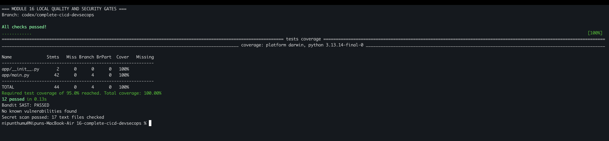
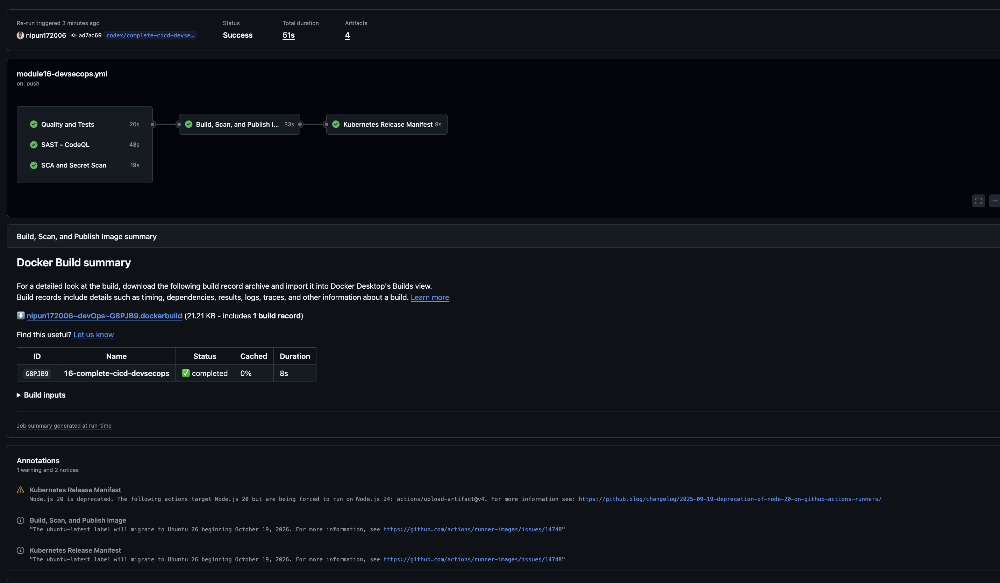
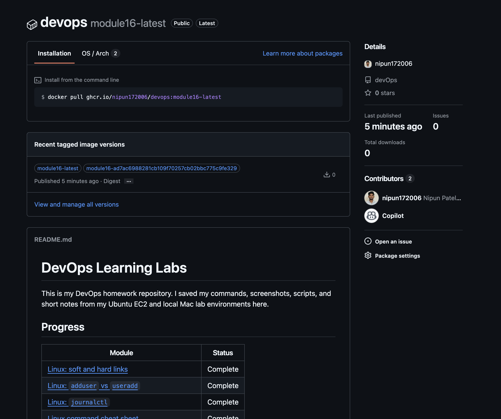
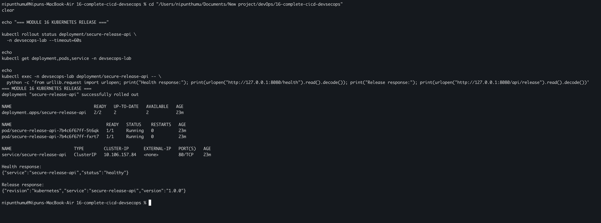

# Complete CI/CD DevSecOps Pipeline

I built a small Flask release-information API and protected its delivery with
automated quality and security gates. The pipeline tests the application,
scans the source and dependencies, checks for committed secrets, builds and
scans a non-root container image, publishes an approved image to GitHub
Container Registry (GHCR), and creates a deployable Kubernetes manifest.

## Pipeline flow

```text
Push or pull request
        |
        +--------> Quality: Ruff + Pytest
        +--------> SAST: CodeQL
        +--------> SCA: pip-audit + secret scan
                         |
                         v
                 Build container image
                         |
                         v
                 Trivy security gate
                    /             \
                 FAIL             PASS
                  stop              |
                                    v
                              Publish to GHCR
                                    |
                                    v
                         Render Kubernetes release
```

Workflow: [`../.github/workflows/module16-devsecops.yml`](../.github/workflows/module16-devsecops.yml)

## Project structure

```text
16-complete-cicd-devsecops/
├── app/                    Flask application
├── tests/                  API and security-header tests
├── scripts/                Secret scan and manifest rendering
├── k8s/                    Hardened Deployment and Service
├── Dockerfile              Non-root production image
├── requirements.txt        Pinned runtime dependencies
├── requirements-dev.txt    Pinned test and security tools
└── SECURITY.md             Vulnerability reporting policy
```

## Task 1: Run local quality and security checks

```bash
cd 16-complete-cicd-devsecops
python3.13 -m venv .venv
source .venv/bin/activate
python -m pip install --upgrade pip
python -m pip install -r requirements-dev.txt
make validate
```

The validation target runs Ruff, twelve Pytest checks with coverage, Bandit
SAST, pip-audit SCA, and a repository secret scan. Any failure stops the
command and blocks later delivery stages.



## Task 2: Build, scan, and test the container

```bash
docker build -t module16-devsecops:local .
docker run --rm -d --name module16-api -p 8080:8080 module16-devsecops:local
curl -s http://localhost:8080/health
curl -s http://localhost:8080/api/release
docker stop module16-api
```

The CI workflow scans the exact image with Trivy. A CRITICAL vulnerability
causes a non-zero exit code, so the registry login and push cannot run.

The successful workflow shows that the container build and Trivy gate ran only
after the three source-level gates passed, and that the release manifest was
created only after the approved image was published.



## Task 3: Publish only an approved image

On a push, the container job authenticates to `ghcr.io` with the temporary
GitHub token and publishes two tags only after all required gates pass:

```text
ghcr.io/nipun172006/devops:module16-<commit-sha>
ghcr.io/nipun172006/devops:module16-latest
```

The workflow uses job-level least-privilege permissions. Source-reading jobs
cannot publish packages; only the gated container job receives
`packages: write`.

The successful run published both the moving convenience tag and an immutable
commit-derived tag to the repository's public GHCR package.

- [Successful GitHub Actions run](https://github.com/nipun172006/devOps/actions/runs/39825619219)
- [Published GHCR package](https://github.com/nipun172006/devOps/pkgs/container/devops)



## Task 4: Deploy and verify on local Kubernetes

GitHub-hosted runners cannot reach the Minikube cluster on my laptop. The
pipeline therefore creates a release manifest artifact, while I perform the
rollout against Minikube and verify the same hardened workload locally.

```bash
minikube image load module16-devsecops:local
./scripts/render_manifest.sh module16-devsecops:local build/k8s-local
kubectl apply -f build/k8s-local/namespace.yaml
kubectl apply -f build/k8s-local/deployment.yaml
kubectl apply -f build/k8s-local/service.yaml
kubectl rollout status deployment/secure-release-api \
  -n devsecops-lab --timeout=180s
kubectl get deployment,pods,service -n devsecops-lab
kubectl port-forward -n devsecops-lab service/secure-release-api 8080:80
```

In another terminal:

```bash
curl -s http://localhost:8080/health
curl -s http://localhost:8080/api/release
```



## Security controls

- The container runs as UID `10001`, drops every Linux capability, prevents
  privilege escalation, and uses a read-only root filesystem.
- Readiness, liveness, and startup probes protect the Kubernetes rollout.
- Runtime and development dependencies are version-pinned and audited.
- No credential is stored in source. GHCR authentication uses the automatic,
  short-lived `GITHUB_TOKEN` supplied by GitHub Actions.
- Third-party security and container actions are pinned to reviewed release
  commit SHAs.
- The Kubernetes manifest uses resource requests and limits and a restricted
  security context.

## What I understood

- SAST checks application source, while SCA checks third-party dependencies.
- Secret scanning reduces the chance of credentials entering Git history.
- An image scan covers operating-system and language packages in the final
  deployable artifact.
- A scanner produces findings; a security gate decides whether delivery may
  continue.
- `needs` expresses the trust chain between jobs and blocks downstream work
  when a required job fails.
- CI can publish an immutable commit-tagged image without having network
  access to a developer's local Kubernetes cluster.
- A real leaked secret must be revoked or rotated; deleting it from the latest
  source file is not sufficient.

## References

- [GitHub CodeQL documentation](https://docs.github.com/en/code-security/code-scanning/introduction-to-code-scanning/about-code-scanning-with-codeql)
- [Publishing Docker images with GitHub Actions](https://docs.github.com/en/actions/use-cases-and-examples/publishing-packages/publishing-docker-images)
- [pip-audit](https://github.com/pypa/pip-audit)
- [Trivy image scanning](https://trivy.dev/latest/docs/target/container_image/)
- [Kubernetes security contexts](https://kubernetes.io/docs/tasks/configure-pod-container/security-context/)
