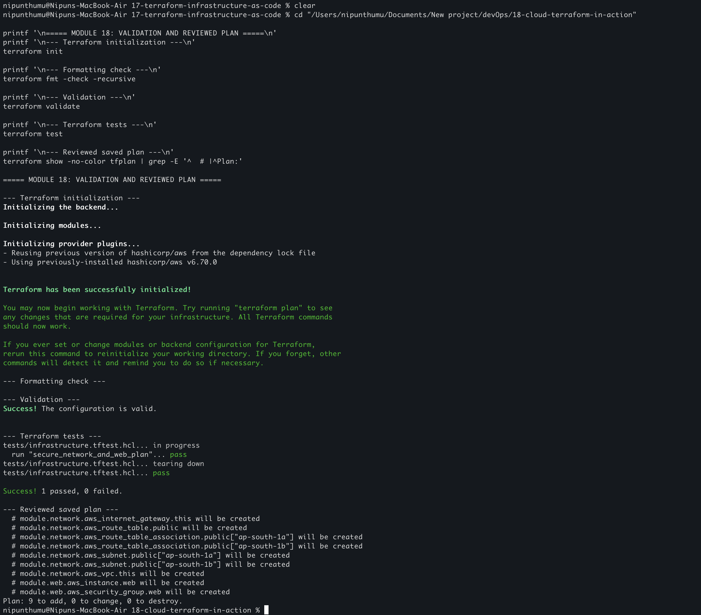
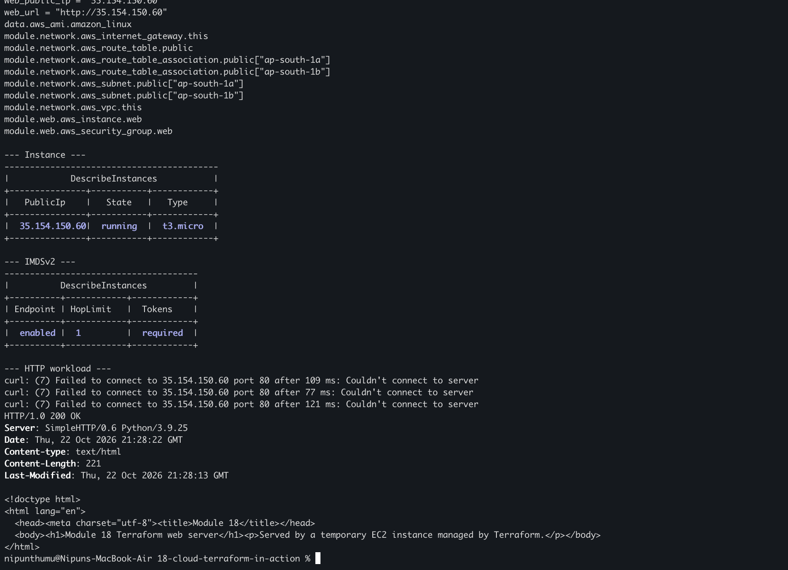
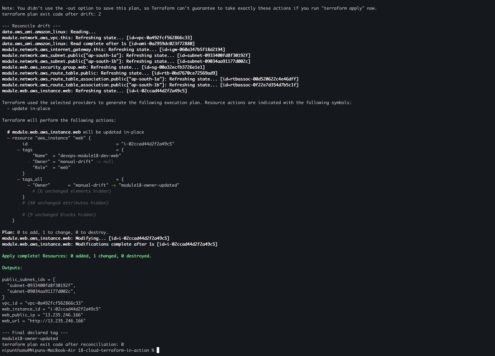
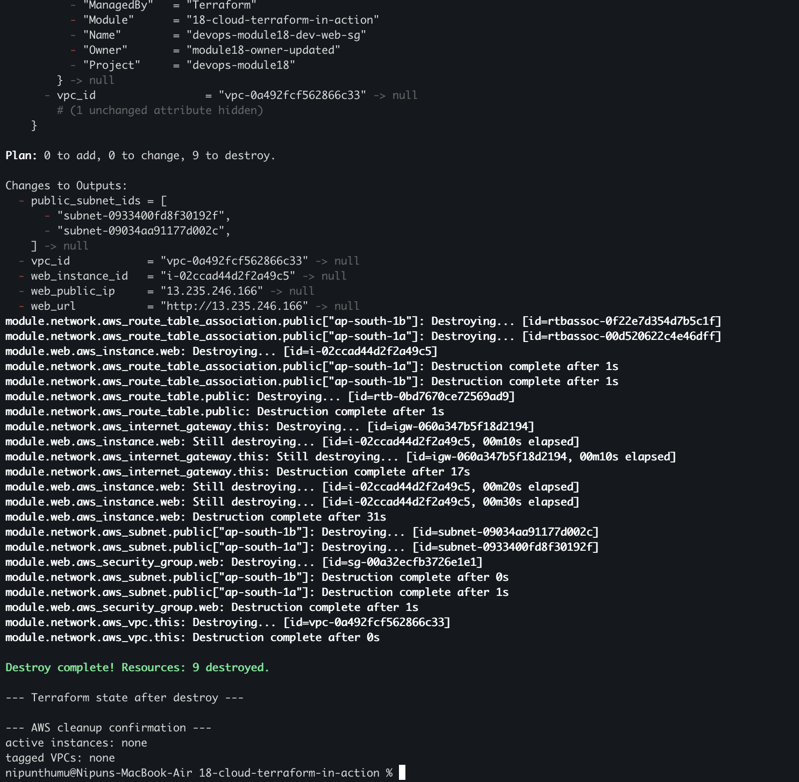

# Cloud & Terraform in Action

I built and tested a small, temporary AWS environment with Terraform. The lab
uses reusable network and web-workload modules, creates two public subnets in
`ap-south-1`, runs one small EC2 web server, verifies the live AWS configuration,
demonstrates an in-place tag update and drift reconciliation, and destroys all
assignment resources after verification.

## Architecture

```text
Terraform root module
        |
        +--> network module
        |      +--> VPC 10.18.0.0/16
        |      +--> public subnet ap-south-1a --+
        |      +--> public subnet ap-south-1b --+--> Internet Gateway
        |      +--> public route table
        |
        +--> web module
               +--> HTTP-only security group
               +--> encrypted 8 GiB gp3 root volume
               +--> IMDSv2-required t3.micro EC2 instance
               +--> temporary Python HTTP service
```

The public HTTP endpoint was intentional for the live verification. No SSH
rule, key pair, NAT Gateway, load balancer, database, or persistent storage was
created.

## Project structure

```text
18-cloud-terraform-in-action/
├── versions.tf                 Terraform and AWS provider constraints
├── providers.tf                Region and common tags
├── variables.tf                Typed, validated inputs
├── main.tf                     AMI lookup and module composition
├── outputs.tf                  VPC, subnet, instance, and URL outputs
├── terraform.tfvars.example    Safe example values
├── Makefile                    Repeatable Terraform commands
├── modules/
│   ├── network/                VPC, subnets, IGW, routes, associations
│   └── web/                    Security group, EC2, user-data workload
└── tests/
    └── infrastructure.tftest.hcl  Offline security-control assertions
```

Terraform state, plans, local variable files, provider caches, credentials,
and logs are ignored by `.gitignore`. The committed
`.terraform.lock.hcl` records the AWS provider selection.

## Prerequisites and authentication

I used the existing AWS CLI credential chain and did not put credentials in the
configuration.

```bash
terraform version
aws --version
aws sts get-caller-identity
```

The lab defaults to `ap-south-1`. To create local variables without exposing
them to Git:

```bash
cp terraform.tfvars.example terraform.tfvars
```

## Task 1: Initialize, format, validate, test, and review the plan

```bash
terraform init
terraform fmt -recursive
terraform fmt -check -recursive
terraform validate
terraform test
terraform plan -out=tfplan
terraform show -no-color tfplan
```

The Terraform test uses a mock AWS provider and checks the VPC DNS settings,
public subnet behavior, HTTP rule, encrypted root volume, and required IMDSv2
tokens without creating AWS resources. The real plan reported nine low-cost
resources to add: one VPC, two subnets, an internet gateway, a route table, two
associations, one security group, and one EC2 instance.



## Task 2: Apply and verify the live AWS configuration

```bash
terraform apply tfplan
terraform output
terraform state list
```

I independently checked the running instance and network through the AWS API:

```bash
INSTANCE_ID=$(terraform output -raw web_instance_id)
VPC_ID=$(terraform output -raw vpc_id)
SG_ID=$(aws ec2 describe-instances --region ap-south-1 --instance-ids "$INSTANCE_ID" \
  --query 'Reservations[0].Instances[0].SecurityGroups[0].GroupId' --output text)
VOLUME_ID=$(aws ec2 describe-instances --region ap-south-1 --instance-ids "$INSTANCE_ID" \
  --query 'Reservations[0].Instances[0].BlockDeviceMappings[0].Ebs.VolumeId' --output text)
aws ec2 describe-instances --region ap-south-1 --instance-ids "$INSTANCE_ID"
aws ec2 describe-vpcs --region ap-south-1 --vpc-ids "$VPC_ID"
aws ec2 describe-security-groups --region ap-south-1 --group-ids "$SG_ID"
aws ec2 describe-volumes --region ap-south-1 --volume-ids "$VOLUME_ID"
curl --fail "$(terraform output -raw web_url)"
terraform plan -detailed-exitcode
```

The live checks showed a running `t3.micro`, two public subnets, an HTTP-only
security-group rule, IMDSv2 required, an encrypted 8 GiB gp3 root volume, a
successful HTTP response, and an idempotent Terraform plan with exit code 0.



## Task 3: Demonstrate an update and drift reconciliation

I changed only the ignored local `owner` value from `devops-student` to
`module18-owner-updated`. Terraform proposed seven `update in-place` operations,
not replacement, and the AWS API confirmed the updated tag.

```bash
terraform plan
terraform apply
aws ec2 describe-instances --region ap-south-1 --instance-ids "$INSTANCE_ID" \
  --query 'Reservations[0].Instances[0].Tags[?Key==`Owner`].Value|[0]' \
  --output text
```

For reconciliation, I changed the instance `Owner` tag directly with
`aws ec2 create-tags`, ran `terraform plan -detailed-exitcode`, and observed
exit code 2 with a one-resource in-place correction. Terraform then restored
the declared tag and the next detailed plan returned exit code 0.



## Task 4: Review and perform cleanup

```bash
terraform plan -destroy
terraform destroy
terraform state list
aws ec2 describe-instances --region ap-south-1 \
  --filters 'Name=tag:Module,Values=18-cloud-terraform-in-action' \
           'Name=instance-state-name,Values=pending,running,stopping,stopped,shutting-down' \
  --query 'Reservations[].Instances[].InstanceId' --output text
aws ec2 describe-vpcs --region ap-south-1 \
  --filters 'Name=tag:Module,Values=18-cloud-terraform-in-action' \
  --query 'Vpcs[].VpcId' --output text
```

The reviewed destroy removed all nine Terraform-managed resources. The state
list was empty, and AWS returned no active assignment instance or tagged VPC.



## Security controls

- The security group permits only TCP 80 for the intentionally public demo;
  SSH is not enabled.
- IMDSv2 tokens are required and the metadata hop limit is 1.
- The root volume is encrypted gp3 storage and is deleted with the instance.
- The instance has no key pair, IAM role, or embedded secret.
- Network resources use a dedicated VPC and public subnets with explicit routes.
- Variables are typed and validated, and provider versions are locked.
- State, plans, real variable files, provider caches, credentials, and logs are
  excluded from Git.

## Cost-conscious design

I used one `t3.micro`, an 8 GiB gp3 root volume, one internet gateway, and no
NAT Gateway, load balancer, database, or provisioned service. The instance and
network were destroyed immediately after live verification.

## What I understood

- A root Terraform module can compose focused reusable infrastructure modules.
- A plan is a reviewable description of the API operations Terraform intends to
  perform; applying a saved plan makes the reviewed actions repeatable.
- Terraform state is the link between resource addresses and live AWS IDs.
- Provider default tags make ownership and cleanup easier to audit.
- Terraform can detect an AWS-side tag drift and reconcile it without replacing
  the instance.
- Security controls must be verified through the cloud API, not only inferred
  from source configuration.
- Temporary cloud labs need an explicit destroy and an independent cleanup
  check.

## References

- [Terraform core workflow](https://developer.hashicorp.com/terraform/intro/core-workflow)
- [Terraform module documentation](https://developer.hashicorp.com/terraform/language/modules)
- [AWS provider authentication](https://registry.terraform.io/providers/hashicorp/aws/latest/docs#authentication-and-configuration)
- [Amazon VPC documentation](https://docs.aws.amazon.com/vpc/latest/userguide/what-is-amazon-vpc.html)
- [EC2 instance metadata options](https://docs.aws.amazon.com/AWSEC2/latest/UserGuide/configuring-instance-metadata-options.html)
- [AWS EBS encryption](https://docs.aws.amazon.com/ebs/latest/userguide/ebs-encryption.html)
