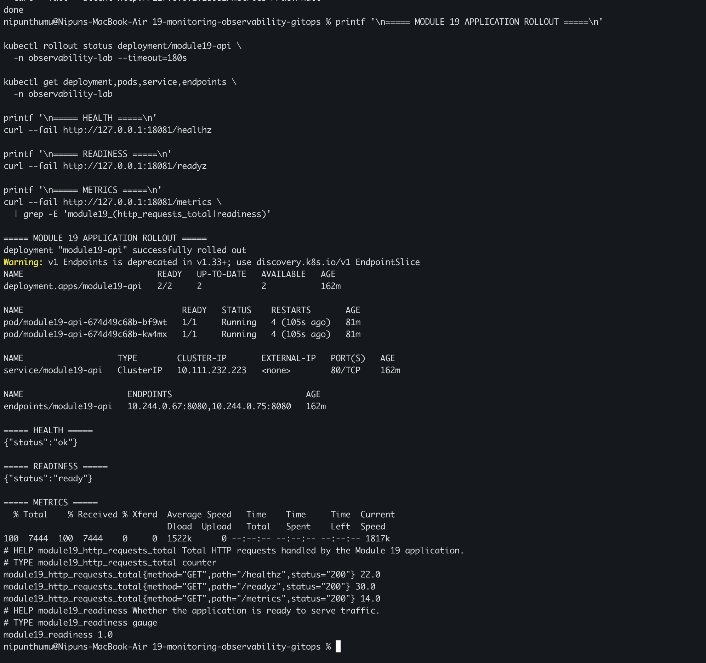
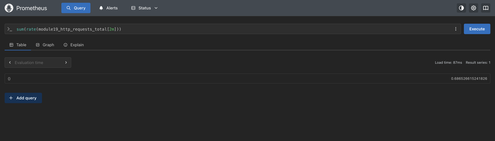
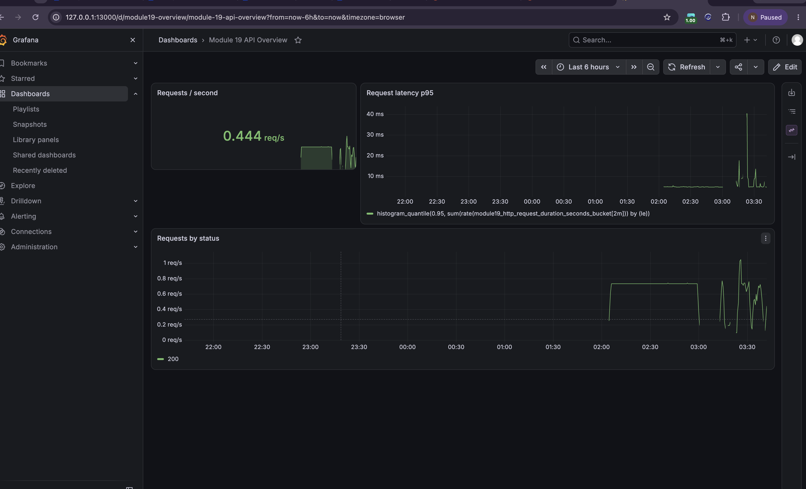
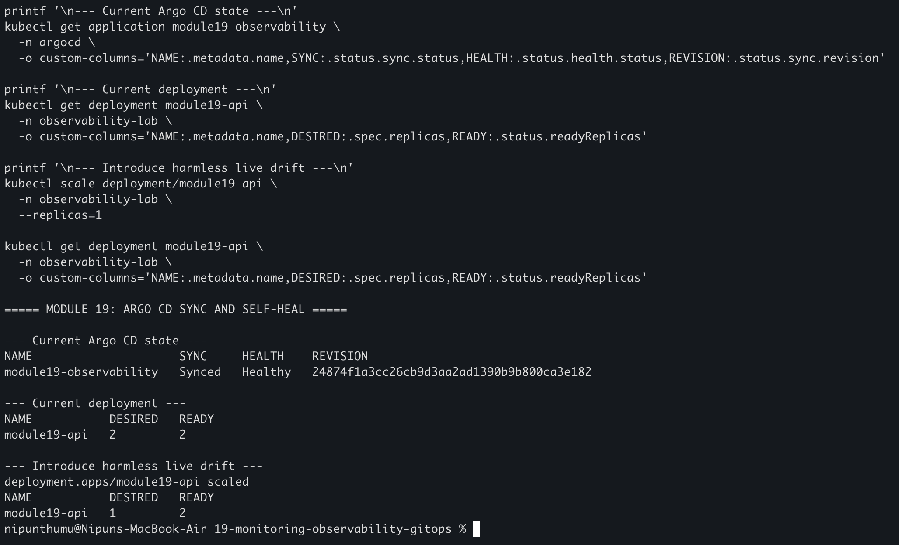

# Monitoring, Observability & GitOps

I built a small Flask application for Minikube that exposes health checks and
Prometheus metrics. I deployed it with hardened Kubernetes settings, installed
a pinned local Prometheus and Grafana stack, verified a real target and
PromQL result, provisioned a dashboard and alert, and used an Argo CD
Application to reconcile only the `observability-lab` namespace.

## Architecture

```text
GitHub repository
        |
        v
Argo CD Application  -- automated sync, prune, self-heal --> observability-lab
        |                                                     |
        |                                                     +--> Deployment (2 replicas)
        |                                                     +--> ClusterIP Service
        |                                                     +--> ServiceMonitor
        |                                                     +--> PrometheusRule
        |                                                     +--> Grafana dashboard ConfigMap
        |
        +--> Prometheus <-- /metrics -- module19-api pods
        |
        +--> Grafana <-- PromQL dashboards and alert views
```

The application image is built locally and loaded into Minikube. The Argo CD
Application uses `imagePullPolicy: IfNotPresent`, so the local image is
available without publishing a registry credential or exposing a public
service.

## Monitoring, observability, and GitOps

- **Monitoring** is the collection of known signals such as request rate,
  latency, readiness, and error counts.
- **Metrics** are numeric time series. This lab exposes counters, a latency
  histogram, an application-info gauge, and a readiness gauge.
- **Logs** are event records emitted by the container runtime and Gunicorn. I
  inspected them when the first read-only filesystem deployment exposed the
  need for a writable `/tmp` `emptyDir`.
- **Traces** connect one request across services and would be the next signal
  to add with OpenTelemetry; this single-service lab explains the concept but
  does not need a tracing backend.
- **Observability** combines metrics, logs, and traces so an operator can ask
  new questions about system behavior rather than only check predefined
  thresholds.
- **GitOps** makes Git the desired state. Argo CD compares the repository with
  the live namespace, syncs committed changes, prunes removed objects, and
  self-heals safe manual drift.

## Project structure

```text
19-monitoring-observability-gitops/
├── app/                         Flask API and Prometheus instrumentation
├── tests/                       Application behavior tests
├── Dockerfile                   Non-root local image
├── requirements*.txt            Pinned runtime and test dependencies
├── k8s/
│   ├── namespace.yaml           Dedicated assignment namespace
│   ├── deployment.yaml          Probes, resources, and restricted security
│   ├── service.yaml             ClusterIP service
│   ├── servicemonitor.yaml      Prometheus target discovery
│   ├── prometheusrule.yaml      Error-rate alert
│   └── dashboard-configmap.yaml Grafana dashboard JSON
├── helm/
│   ├── kube-prometheus-stack-values.yaml
│   └── argo-cd-values.yaml
├── gitops/application.yaml      Scoped Argo CD Application
├── scripts/validate.sh          Repeatable local checks
└── Makefile                     Common commands
```

## Prerequisites

```bash
docker version
minikube status
kubectl version --client
helm version
python3 --version
```

I reused the running Minikube profile and the Argo CD controllers already
present in that local cluster. The monitoring release created for this module
is named `monitoring` in namespace `monitoring`; the application is the only
workload managed by this module's Argo CD Application.

## Task 1: Test and build the application

```bash
python3 -m venv .venv
.venv/bin/pip install -r requirements-dev.txt
.venv/bin/python -m pytest tests -q
docker build -t module19-observability:local .
docker run --rm -d --name module19-api-smoke -p 18080:8080 module19-observability:local
curl --fail http://127.0.0.1:18080/healthz
curl --fail http://127.0.0.1:18080/metrics
docker stop module19-api-smoke
```

The application tests passed three checks. The container smoke test returned a
healthy JSON response and real Prometheus series for the requests made during
the check.

## Task 2: Deploy and verify on Minikube

```bash
minikube image load module19-observability:local
kubectl apply -f k8s/namespace.yaml
kubectl apply -f k8s/deployment.yaml
kubectl apply -f k8s/service.yaml
kubectl rollout status deployment/module19-api \
  -n observability-lab --timeout=180s
kubectl get deployment,pods,service,endpoints -n observability-lab
kubectl port-forward -n observability-lab service/module19-api 18081:80
```

In another terminal I verified the endpoints and generated controlled traffic:

```bash
curl --fail http://127.0.0.1:18081/healthz
curl --fail http://127.0.0.1:18081/readyz
curl --fail http://127.0.0.1:18081/metrics
```

The Deployment runs two replicas with startup, readiness, and liveness probes,
resource requests and limits, a non-root UID, dropped capabilities, no service
account token, a read-only root filesystem, and a writable temporary directory
only for Gunicorn's runtime files.



## Task 3: Install Prometheus and Grafana

The monitoring stack used the pinned `kube-prometheus-stack` chart version
`92.11.0`:

```bash
helm repo add prometheus-community https://prometheus-community.github.io/helm-charts
helm repo update
helm upgrade --install monitoring prometheus-community/kube-prometheus-stack \
  --version 92.11.0 \
  --namespace monitoring --create-namespace \
  -f helm/kube-prometheus-stack-values.yaml \
  --wait --timeout 10m
kubectl get pods -n monitoring
```

Alertmanager, node exporter, kube-state-metrics, default rules, and default
dashboards were disabled to keep the local lab small. Prometheus retention is
one day and the Prometheus and Grafana resources have small local limits.

I then applied the module-specific monitoring objects:

```bash
kubectl apply -f k8s/servicemonitor.yaml
kubectl apply -f k8s/prometheusrule.yaml
kubectl apply -f k8s/dashboard-configmap.yaml
```

## Task 4: Verify target discovery, PromQL, dashboard, and alert

I used port-forwarding instead of a public service. The generated Grafana
password was read from the Kubernetes Secret only in the local shell and was
never printed, committed, or placed in a screenshot.

```bash
kubectl port-forward -n monitoring \
  service/monitoring-kube-prometheus-prometheus 19090:9090
kubectl port-forward -n monitoring \
  service/monitoring-grafana 13000:80
```

The Prometheus target API showed two `module19-api` targets with health `up`.
The real query used for the verification was:

```promql
sum(rate(module19_http_requests_total[2m]))
```

The dashboard is titled `Module 19 API Overview` and contains request rate,
p95 latency, and requests-by-status panels. The alert rule
`Module19ApiErrors` fires when the two-minute 5xx request rate remains above
zero for one minute.





## Task 5: Argo CD sync, Git update, and self-heal

The cluster already contained working Argo CD controllers from earlier local
Kubernetes work, so I reused them rather than replacing unrelated resources.
The Module 19 Application is scoped to the assignment namespace and points to
the public repository path:

```bash
kubectl apply -f gitops/application.yaml
kubectl get application module19-observability -n argocd
```

The Application enables automated sync, pruning, and self-healing. It first
reported `Synced` and `Healthy` at the initial feature-branch revision. I then
changed the declared `APP_VERSION` from `0.1.0` to `0.2.0`, committed and pushed
that change, and observed Argo CD reconcile the Deployment to the new revision.

For the drift demonstration I changed only the live replica count:

```bash
kubectl scale deployment/module19-api -n observability-lab --replicas=1
kubectl get deployment module19-api -n observability-lab
kubectl get application module19-observability -n argocd
```

Argo CD restored the declared replica count of two while the Application
remained `Synced` and `Healthy`.



## Cleanup

The final GitOps demo may be retained while reviewing the repository. To remove
only the resources created for this module:

```bash
kubectl delete application module19-observability -n argocd --ignore-not-found
kubectl delete namespace observability-lab --ignore-not-found
helm uninstall monitoring --namespace monitoring
kubectl delete namespace monitoring --ignore-not-found
```

I did not delete the pre-existing `argocd`, `releaseguard`, `grafana`, or
`prometheus` resources. Port-forward processes were started in foreground
shells and stopped after each verification.

## Security considerations

- The application has no credentials or secret configuration.
- The image runs as UID 10001 with a read-only root filesystem, no privilege
  escalation, all Linux capabilities dropped, and a RuntimeDefault seccomp
  profile.
- The Deployment does not mount a service-account token and has no privileged,
  host-network, host-PID, or public LoadBalancer settings.
- Health probes and resource limits protect the rollout and local node.
- Prometheus and Grafana are reachable only through local port-forwards.
- The Grafana password is generated by Kubernetes and kept outside Git.
- Argo CD manages only the declared `observability-lab` destination namespace.

## What I understood

- Metrics answer known quantitative questions, while observability helps
  investigate unknown failure modes using correlated signals.
- A counter is useful for rates, and a histogram supports latency quantiles.
- A ServiceMonitor connects a Kubernetes Service to Prometheus discovery.
- A PrometheusRule turns a metric condition into an actionable alert.
- A dashboard is a curated view over PromQL rather than a replacement for
  investigating logs or traces.
- GitOps separates desired state in Git from live state in the cluster.
- Self-healing makes a safe manual drift demonstration observable and
  repeatable.

## References

- [Kubernetes probes](https://kubernetes.io/docs/concepts/configuration/liveness-readiness-startup-probes/)
- [Kubernetes security context](https://kubernetes.io/docs/tasks/configure-pod-container/security-context/)
- [Prometheus exposition format](https://prometheus.io/docs/instrumenting/exposition_formats/)
- [Prometheus Operator](https://prometheus-operator.dev/)
- [Grafana dashboard documentation](https://grafana.com/docs/grafana/latest/dashboards/)
- [Argo CD automated sync](https://argo-cd.readthedocs.io/en/stable/user-guide/auto_sync/)
- [Argo CD self-healing](https://argo-cd.readthedocs.io/en/stable/user-guide/auto_sync/#automatic-self-healing)
